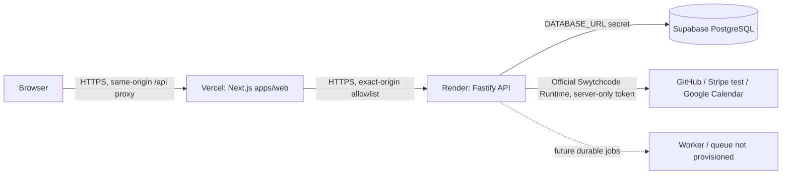

# VendorProof

**Verified work. Traceable invoices.**

VendorProof is a work-to-invoice reconciliation SaaS for independent software consultants, technical freelancers, and small engineering agencies. It links repository activity and human-approved time or milestone evidence to reviewable invoice previews. The product is designed to make billing easier to explain—not to treat code activity as proof of billable hours.

**Repository:** [hitakshijoshi20072911/scppi](https://github.com/hitakshijoshi20072911/scppi)
**Product name:** VendorProof
**Tags:** SaaS, freelancer invoicing, agency operations, work evidence, GitHub, reconciliation, audit trail, approval workflow, PostgreSQL, Next.js, Fastify
**Status:** Stage 5 recovery and hardening is on `feat/stage-5-hosted-recovery`; CI passed for commits `d98c3c2` and `301c10e`. This branch is not merged or deployed as a complete hosted product.

## Problem and intended users

Consultants and small agencies often reconstruct work from pull requests, time trackers, notes, contracts, and spreadsheets when billing. Evidence becomes scattered, client scope is hard to audit, and invoice disputes can arise because there is no clear link between an agreement, accepted work, and an amount. VendorProof aims to provide a workspace where those relationships are explicit and reviewable.

The central rules are deliberate: GitHub activity is evidence of engineering activity, never a substitute for approved hours; amounts come from contract terms and approved time entries or accepted fixed-price milestones; calculations use integer minor units; and an authorized human must review an invoice preview before any financial provider operation.

## Current implementation and verified status

The repository contains a Next.js public site and fictional demo; account/session and workspace APIs; client, project, contract, time-entry, milestone and audit-event APIs; repository mapping and GitHub evidence/reconciliation code; and an immutable invoice-preview/review workflow. Stage 5 source changes include CRUD/session reliability work, exact-origin handling and a same-origin API proxy, tenant RLS context work, and fake-tested Swytchcode adapters. Stripe and Google Calendar methods are currently disabled in the runtime allowlist pending security gates. The branch remains incomplete until the approved hosted migration, runtime credentials, provider authentication, and end-to-end deployment are verified.

**Verification:** GitHub Actions CI for `d98c3c216c421d41ea5a963f31c575680ff03187` and `301c10eb359539aa56e0a430dbb6c7372c4999e6` passed on 2026-11-10. CI includes quality, unit, Playwright browser smoke, build, migration-metadata, dependency-audit, and Swytchcode tooling checks. The follow-up also passed local formatting, lint, typecheck, 76 unit tests, migration metadata check, server/web production builds, and dependency audit. A disposable PostgreSQL 16 exercise applied migrations `0000`–`0005` and tested least-privilege role normalization, owner/admin membership writes, active-membership RLS, cross-workspace read/write denial, and cross-database ownership blocking. None of this proves hosted authenticated CRUD, live provider calls, or Supabase-specific policy behavior.

**Hosted verification:** The existing Vercel Preview deployment for this branch is `READY` and built from the exact branch SHA, but Vercel has no branch-specific Preview environment variables. The only `NEXT_PUBLIC_API_BASE_URL` variable is production-scoped. The frontend therefore fails closed with workspace API actions disabled in Preview; it is not connected to either production or isolated staging data. Vercel SSO protection is enabled for non-custom deployment domains. The authenticated application workflow has not passed a complete hosted end-to-end test. Both designated Supabase projects are healthy, but their application migration ledgers contain only migrations `0000`–`0002`. The repository requires `0003_commit_provenance.sql` and `0004_phase3_invoice_approval.sql` for later evidence and invoice features; hosted schema inventory confirms the invoice tables are absent. The Supabase staging project is on the Free plan, which explicitly has no scheduled project backups. No hosted schema migration has been applied as part of this work; all migration testing described above used disposable local PostgreSQL only.

**Release blockers:** A recoverable logical backup and safe rotation of the previously exposed database credentials are required before hosted database changes; Supabase plan upgrade is not authorized. Production/staging API runtime now requires a separate restricted `APP_DATABASE_URL`; it is not yet provisioned or tested, and `0005` is unapplied in hosted environments. Swytchcode owner GitHub OAuth reports expired, and the previously pasted Swytchcode token requires rotation. Stripe and Calendar methods are disabled pending verified test-account binding and durable Calendar ownership provenance; neither provider has live verification. The Stage 5 branch is pushed but not merged or deployed. Do not treat the public health checks or mocked tests as proof that the product is production-ready.

## Product scope and limitations

Implemented foundations include workspace authorization, records for clients/projects/contracts, human-entered time and milestones, repository mapping, reconciliation state transitions, audit events, deterministic invoice previews, immutable review decisions, and source-level integration adapters. The public demo is fictional and deterministic; it does not create real records.

Current limitations include pending hosted database migrations, pending restricted-role RLS integration verification, pending hosted CRUD/session verification, pending OAuth/API-key setup via Swytchcode, and pending end-to-end tests against isolated hosted data. Stripe's draft adapter is source-only and provider write methods are disabled until the connected credential is independently verified as test-mode and retry/idempotency behavior is proven; no finalize/send/charge/refund/payout operation is supported. Calendar write methods are disabled until created-calendar provenance is durably stored and verified. There is no implemented production worker/queue, subscription billing, accounting export, tax/VAT computation, client portal, guaranteed email delivery, or legal/accounting advice. Do not use real customer/financial data until the explicit release gates in the deployment guide have passed.

## System architecture



VendorProof is a TypeScript modular monolith: `apps/web` is the browser client, `server` hosts the Fastify API and future worker entrypoint, and `packages/shared` holds shared validation/types. The browser never receives database or provider credentials. The API derives the workspace/tenant from the authenticated session and invokes external providers only through the Swytchcode Runtime. An absent/misconfigured integration must fail closed; there is no direct-provider fallback. Vercel and Render are existing services, but this branch's proxy/origin changes have not been deployed.

### Trust and data flow

1. The user signs in and receives an HTTP-only secure session cookie; mutation requests also require the session-bound CSRF token and an allowed exact origin.
2. The API resolves the user's active workspace membership and role, validates request schemas, and uses transaction-local database context for workspace/user/session identity.
3. Source records and invoice previews are persisted in PostgreSQL. Evidence is mapped to projects and reconciled deterministically; human decisions are versioned and audited.
4. Only after the relevant user approval may the server attempt an explicitly allowed provider action. Provider responses and ambiguous writes are handled as untrusted data; an uncertain Stripe write is not blindly retried.

## Database schema and migration status

The intended schema is defined by ordered SQL migrations in `server/src/db/migrations/`:

| Migration                                 | Purpose                                         | Key objects                                                                                                                                      |
| ----------------------------------------- | ----------------------------------------------- | ------------------------------------------------------------------------------------------------------------------------------------------------ |
| `0000_phase0_baseline.sql`                | Connectivity baseline                           | phase-zero sentinel and migration ledger                                                                                                         |
| `0001_phase1_foundation.sql`              | Identity and core workspace domain              | `app_user`, `session`, `workspace`, `membership`, `client`, `project`, `contract`, `time_entry`, `milestone`, `audit_event`, `source_connection` |
| `0002_phase2_evidence_reconciliation.sql` | Evidence and reconciliation                     | `scope_rule`, `work_item`, `billing_run`, `run_source`, `run_item`, `provider_execution` and related constraints/policies                        |
| `0003_commit_provenance.sql`              | Link normalized evidence to upstream records    | `work_item.related_external_id`, `work_item.repository_external_id`, index                                                                       |
| `0004_phase3_invoice_approval.sql`        | Immutable invoice preview/review                | `invoice_preview`, `invoice_line`, `invoice_evidence_claim`, `invoice_review`, integrity constraints and policies                                |
| `0005_vendorproof_app_rls.sql`            | Restricted application role and tenant policies | core identity/workspace RLS policies and grants; requires review and effective-role tests before use                                             |

The principal relationships are: a workspace owns clients and projects; a project belongs to a client; contracts bind clients/projects to billing terms; time entries and milestones reference projects/contracts; source connections bind repositories to projects; work items and billing runs capture reconciliation evidence; invoice previews snapshot a billing run and its immutable invoice lines; evidence claims prevent reuse while a preview is open; review rows record approve/reject decisions; and audit events record consequential actions. UUID primary keys, workspace-scoped foreign keys, status checks, content hashes, and database constraints defend consistency. Money is stored as integer minor units with explicit currency codes.

**Hosted databases do not yet match the latest migration chain.** As of 2026-11-07, the user-designated staging database and isolated test database both report only `0000`–`0002` in `public.__vendorproof_migrations`. The test database contains no app users or business rows; staging contains existing user/workspace/session data. Staging's Free plan has no scheduled backups. Do not run `npm run db:migrate` against either hosted database until a recoverable logical backup exists, the exposed database credentials have been rotated, the migration chain is reviewed, and the effective runtime role/policies are tested.

## API design

The versioned API is rooted at `/api/v1`. Successful responses use `{ "data": ... }`; errors use a stable code and sanitized message. JSON request bodies are validated at the boundary, workspace IDs are checked against authenticated membership, and mutation endpoints require CSRF/origin validation. The full route implementation is under `server/src/api/routes/`; `GET /health/live` and `GET /health/ready` are operational health endpoints, not business-readiness checks.

| Area            | Route families                                                                                                  | Purpose                                                                                             |
| --------------- | --------------------------------------------------------------------------------------------------------------- | --------------------------------------------------------------------------------------------------- |
| Authentication  | `/auth/register`, `/auth/login`, `/auth/logout`, `/auth/me`                                                     | Account registration, session lifecycle and current identity                                        |
| Workspace       | `/workspaces`, `/workspaces/:workspaceId/members`                                                               | Create workspace and manage/view membership                                                         |
| Core records    | `/workspaces/:workspaceId/{clients,projects,contracts,time-entries,milestones}`                                 | List/create records; generic record `PATCH`/`DELETE` routes and explicit status transitions         |
| Audit           | `/workspaces/:workspaceId/audit-events`                                                                         | Bounded audit history                                                                               |
| GitHub/evidence | `/workspaces/:workspaceId/projects/:projectId/sources`, `/runs`, reconciliation and decision routes             | Map a repository, connect/verify/disconnect, ingest bounded evidence, classify and review decisions |
| Contracts       | `/workspaces/:workspaceId/projects/:projectId/contracts/:contractId/scope-rules`                                | Configure project/contract evidence scope                                                           |
| Invoices        | `/workspaces/:workspaceId/invoice-eligible-runs`, `/invoice-previews` and `/invoice-previews/:invoiceId/review` | Preview eligible evidence and owner approve/reject with version/hash checks                         |

Invoice API data comes from the Phase 3 migration and is therefore not functional against the current hosted schema until the migration gate is cleared. See `docs/api-inventory.md` for the canonical provider method register and verification levels; do not infer live provider availability from route presence or fake tests.

## Repository layout

- `apps/web/` — Next.js public site, fictional demo, authenticated workspace, management screens and browser API client.
- `server/src/api/` — Fastify API and route modules.
- `server/src/db/` — Postgres client, transaction context, migration runner and SQL migrations.
- `server/src/swytchcode/` — official runtime executor and provider adapters.
- `server/tests/` — unit tests, including fake-runtime provider safety tests.
- `packages/shared/` — shared types/validation utilities.
- `.swytchcode/` — provider Wrekenfiles and method allowlist; schemas are not proof of authentication or live execution.
- `docs/` — deployment, threat model, API/provider inventory, phase notes, runbooks and roadmap.

## Local setup

Prerequisites: Node.js `22.23.4` (see `.node-version`), npm 10+, Git, and a local PostgreSQL 16+ instance. Docker Compose is provided for local development. No production credentials are required for unit tests or the fictional demo.

```bash
git clone https://github.com/hitakshijoshi20072911/scppi.git
cd scppi
nvm use                 # or install the version in .node-version
npm ci
cp .env.example .env    # keep real values out of Git
```

Set `DATABASE_URL` in the ignored `.env` to a **local** PostgreSQL database before applying local migrations. Start the local database using `docker compose up -d postgres`, then run:

```bash
set -a && . ./.env && set +a
npm run db:migrate
```

Run the API and web app in separate terminals (the API defaults to port 3000; Next.js defaults to port 3000 too, so select a separate web port):

```bash
# Terminal 1
set -a && . ./.env && set +a
npm run dev:api

# Terminal 2
NEXT_PUBLIC_API_BASE_URL=http://localhost:3000 npm run dev --workspace=@vendorproof/web -- --port 3001
```

Set `API_CORS_ORIGIN=http://localhost:3001` in `.env`. Check API health at `http://localhost:3000/health/live` and `/health/ready`, and open the web app at `http://localhost:3001`. Keep `SWYTCHCODE_TOKEN` server-side; provider methods remain unavailable unless the official Swytchcode setup is completed. Never point local development at the user's hosted staging/production database.

## Quality and release commands

```bash
npm run format:check
npm run lint
npm run typecheck
npm run test:unit
npm run test:e2e
npm run build
npm run db:check
npm audit --omit=dev --audit-level=high
```

`npm run db:check` checks migration metadata; it does not connect to a hosted database. `npm run db:migrate` applies pending migrations to `DATABASE_URL`, which is the migration/development credential; review its target before running. In `staging` and `production`, API queries use only `APP_DATABASE_URL` (the restricted `vendorproof_app` role); the runtime does not fall back to `DATABASE_URL`. Playwright E2E tests require Chromium (`npx playwright install chromium`). Local adapter tests use fakes and must not be reported as external provider verification.

## Hosting and operations

Existing hosting: Vercel project `vendorproof-web` serves `apps/web`; Render `vendorproof-api` hosts the Fastify API; Supabase `venderproof-staging` is the designated primary application database and `venderproof-test` is isolated. Render currently auto-deploys commits to `main`, with pull-request previews disabled. Vercel and Render project settings/secret values must be managed through the provider dashboards or authorized connectors; never copy database/API keys into `NEXT_PUBLIC_*` variables, Git, tickets, or chat.

Deployment sequence: create and verify a protected logical backup; rotate exposed credentials; apply reviewed migrations to the isolated test project; provision separate migration and restricted application database URLs; run migration/RLS/auth/CRUD integration tests through the exact runtime role; repeat recovery checks for staging; apply approved additive migrations; configure distinct preview/staging/production API targets; then verify login, session persistence, workspace CRUD, tenant isolation, GitHub reads, Stripe test-mode draft safety, Calendar resource ownership and health. A healthy `/health/ready` check proves only database connectivity. Rollback should prefer the last known-good application deployment and forward-only schema repair; never reset or delete a database to resolve a migration problem.

Detailed operational guidance: [`docs/deployment.md`](docs/deployment.md), [`docs/production-setup.md`](docs/production-setup.md), [`docs/production.md`](docs/production.md), [`docs/operations/runbook.md`](docs/operations/runbook.md), and [`docs/threat-model.md`](docs/threat-model.md). The existing Supabase Free plan has no scheduled backups; do not upgrade it without explicit authorization. Use a secured logical dump as the no-upgrade recovery path.

## Provider and financial safety

| Provider                       | Intended use                                            | Current evidence/state                                                                                       |
| ------------------------------ | ------------------------------------------------------- | ------------------------------------------------------------------------------------------------------------ |
| GitHub via Swytchcode          | Read bounded PR/commit metadata for mapped repositories | Two used read methods remain enabled; OAuth reports expired and no live verification exists                  |
| Stripe via Swytchcode          | Source-only draft invoice adapter                       | All Stripe methods are disabled pending verified test-account identity, safe retries and a reviewed API path |
| Google Calendar via Swytchcode | Source-only reminders                                   | All Calendar methods are disabled pending durable ownership provenance and OAuth/live verification           |

All provider payloads are untrusted. GitHub reads are bounded and must not ingest source code or diffs. Stripe must be confirmed test-mode before every write; the system does not send/finalize invoices or take payment. Calendar operations must never alter unrelated calendars/events. See [`docs/api-inventory.md`](docs/api-inventory.md) for method IDs, schemas, scopes and verification level. The earlier Swytchcode token and database URLs were exposed in chat and must be rotated before use.

## Security and privacy

- Session cookies are HTTP-only and secure in production; state-changing requests use CSRF protections and exact-origin validation.
- Tenant isolation is enforced by server-side membership checks, transaction-local context and PostgreSQL RLS policies; the restricted runtime-role migration is not yet applied or integration-tested in hosted environments. The application requires `APP_DATABASE_URL` in hosted modes and must never use the migration credential at runtime.
- Provider tokens and database URLs are server-only secrets. Do not place them in frontend builds, logs, screenshots, test fixtures, or repository files.
- Use only synthetic data for tests; minimize provider fields persisted to the application; retain audit records for human approval and consequential state changes.
- Do not interpret engineering activity as hours, or use the software as a substitute for accounting, tax, legal, or professional advice.

## Additional documentation

- [`docs/phase0-validation.md`](docs/phase0-validation.md) — foundation validation.
- [`docs/phase2-implementation.md`](docs/phase2-implementation.md) — evidence/reconciliation scope and blockers.
- [`docs/phase3-implementation.md`](docs/phase3-implementation.md) — invoice-preview boundaries and limitations.
- [`docs/implementation-roadmap.md`](docs/implementation-roadmap.md) — delivery phases.
- [`docs/friction-diary.md`](docs/friction-diary.md) — observed implementation/deployment friction, sanitized of credentials.
