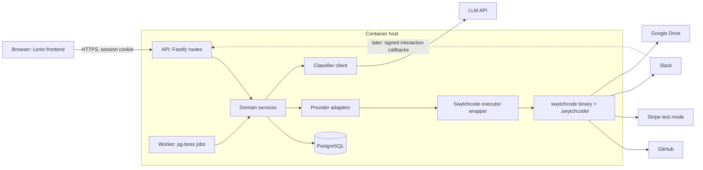
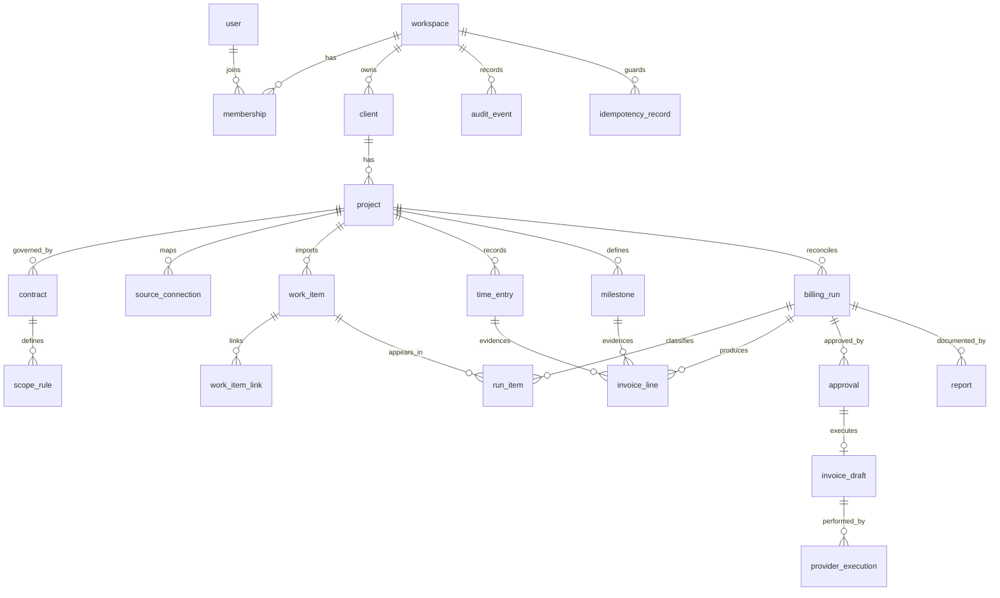
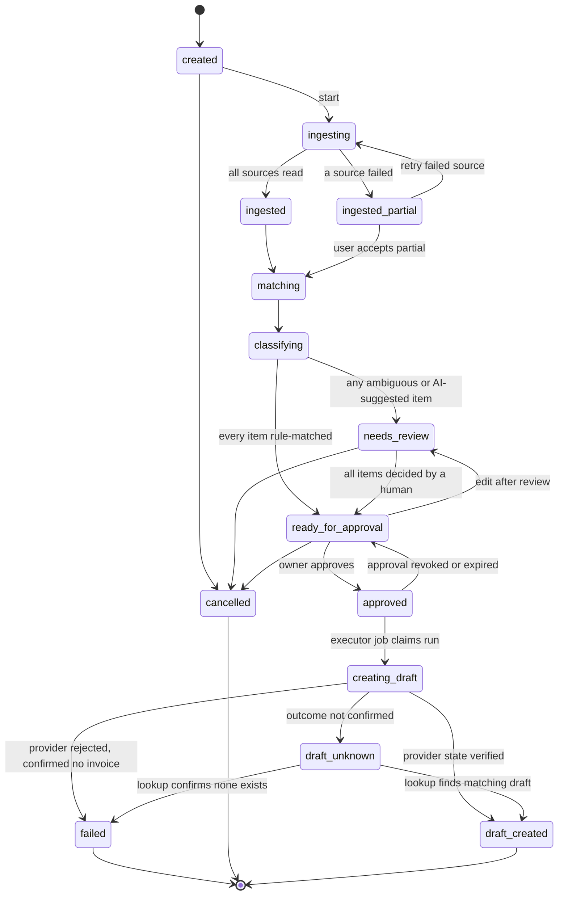

# VendorProof — Architecture Package

Nov 4, 2026 · @daksh

## 1. Critical review, corrected requirements, assumptions

**Verdict:** the concept is sound, but the proposal as written cannot produce a trustworthy invoice. It has no source of billable hours, it tries to ship six integrations in one release, and it leans on API names that were never verified. The fix is a narrower first release built around human-approved time evidence, one financial write, and a hard boundary between AI suggestions and money.

Evidence labels used throughout: **\[Docs\]** confirmed in official public documentation, **\[CLI\]** confirmed by real CLI output, **\[Proposed\]** my design, **\[Unverified\]** must be checked before use, **\[Approve\]** needs your decision.

### Flaws found in the proposal

| # | Flaw | Why it matters | Resolution |
| --- | --- | --- | --- |
| 1 | Step 6 multiplies "approved billable hours" by a rate, but no step creates those hours | Every amount would be invented or inferred from commits and PR size, which the brief forbids | A human-approved time entry (or a fixed milestone price) must exist before any amount is computed (section 3) |
| 2 | Six providers in release one (GitHub, Linear, Drive, Slack, Stripe, time tracker) | Each adds auth, schema, failure and test surface; most are not needed to prove the core loop | First release: GitHub + manual time entries + one financial provider in test mode. Linear, Drive, Slack follow as separate milestones |
| 3 | AI classifies first, rules second | An LLM verdict becomes the default, which inverts accountability | Deterministic scope rules run first; the LLM only sees what rules cannot settle, and its output is a suggestion a human must confirm |
| 4 | Conceptual operations (`repos.listPullRequests`, `invoices.create`, `files.create`, ...) read like real method IDs | Agents will copy them into code | Treated as descriptions only; no ID is used until it appears in a downloaded Wrekenfile (section 7) |
| 5 | Slack "approval" is listed beside dashboard approval | Slack interactions arrive at an inbound endpoint Swytchcode does not protect; signature, replay and identity checks are the app's job | Dashboard is the only approval surface in release one; Slack is notification-only until later |
| 6 | Drive is described as "audit storage" | A Drive file can be edited or deleted by its owner, so it is not tamper-evident | The report is hashed and recorded in VendorProof's own database; Drive holds a private copy and the doc never claims immutability |
| 7 | "Multi-user" is assumed to follow from Swytchcode | Whether the server runtime can select per-user provider credentials is not established | Schema is workspace-scoped from day one; release one connects one provider account per workspace until tenant support is verified \[Unverified\] |
| 8 | The LLM call itself is not accounted for | The model is a separate dependency, and client work metadata would leave the system | Needs a decision on provider, data minimisation and client disclosure \[Approve\] |
| 9 | Retry-on-timeout is implied for invoice creation | A blind retry can create two invoices | Persisted idempotency record plus provider-state check before any retry (section 12) |

### Corrected product requirements

1. **R1.** A billing run belongs to one workspace, client, project and billing period, and uses one frozen snapshot of that project's contract rules.
2. **R2.** Work items are imported with a link to the original provider record and are never edited in place; corrections are new records.
3. **R3.** Every billable amount traces to either an approved time entry or an approved fixed-price milestone. No other source is allowed.
4. **R4.** Classification outcomes are `rule_matched`, `ai_suggested` or `needs_review`; only a human action sets `approved`.
5. **R5.** Amounts are integer minor units with an explicit rounding rule stored on the contract.
6. **R6.** Approval freezes a content hash of the invoice lines; execution aborts if the hash changed.
7. **R7.** The only financial write in release one is creating a **draft** invoice. Finalising, sending and collecting are out of scope.
8. **R8.** A run that lost data from any provider is labelled `partial`, never `complete`.

### Explicit assumptions

- **A1.** The user is a solo freelancer or small agency owner, so one workspace per signed-up account is enough for release one. \[Approve\]
- **A2.** Time evidence is entered manually inside VendorProof first; a time-tracker integration is added only if its methods are verified. \[Proposed\]
- **A3.** Invoices are issued in one currency per project. \[Proposed\]
- **A4.** The web app stack is TypeScript end to end. \[Proposed\]
- **A5.** The existing Lenis frontend is a static or lightly dynamic site that can be adapted; it has not been inspected yet. \[Unverified\]

## 2. Evidence status and integration matrix

**Nothing about any provider is verified yet.** No bundle has been downloaded, so there are no Wrekenfiles, canonical IDs or schemas to rely on. What I could confirm is how Swytchcode itself works.

**Evidence limit:** my fetch tool could not open `docs.swytchcode.com` pages directly in this session. The facts below come from search excerpts of the official CLI repository README, the official runtime package READMEs, and a third-party mirror of the docs index. Treat them as **\[Docs, secondary\]** and re-check the primary pages before Milestone 2.

### What is confirmed about Swytchcode

| Fact | Status | Source |
| --- | --- | --- |
| `tooling.json` defines what is trusted; Wrekenfiles define what is possible | \[Docs\] | [CLI repo](https://gitlab.com/swytchcode/cli) |
| `get` fetches a Wrekenfile plus `methods.json` and `workflows.json` and does not modify `tooling.json`; `add` enables a tool | \[Docs\] | [CLI repo](https://gitlab.com/swytchcode/cli) |
| `exec` supports `--json`, `--raw` and `--dry-run`; `search`, `list`, `info`, `check`, `diff` also exist | \[Docs\] | [CLI repo](https://gitlab.com/swytchcode/cli) |
| Python and Go runtime SDKs are thin wrappers that run `swytchcode exec`; the CLI binary must be installed on the same machine; they add no schema validation, retries or timeouts of their own | \[Docs\] | [Go runtime](https://pkg.go.dev/github.com/swytchcodehq/runtime-go), [Python runtime](https://pypi.org/project/swytchcode-runtime/) |
| The JS/TS runtime (`@swytchcode/runtime`, for Node, Bun, Next.js) is described the same way | \[Docs, secondary\] | [packages mirror](https://raw.githubusercontent.com/api-evangelist/swytchcode/refs/heads/main/packages/swytchcode-packages.yml) |
| Two auth planes: Swytchcode account (`swy login` device flow, or `SWYTCHCODE_TOKEN` for servers and CI, read from the process environment) and separate provider credentials | \[Docs, secondary\] | [auth mirror](https://raw.githubusercontent.com/api-evangelist/swytchcode/refs/heads/main/authentication/swytchcode-authentication.yml) |
| Provider credentials resolve in order: environment variables, the encrypted managed store, then the project `.env`; managed with `swy auth connect/status/disconnect/workspace` | \[Docs, secondary\] | [auth mirror](https://raw.githubusercontent.com/api-evangelist/swytchcode/refs/heads/main/authentication/swytchcode-authentication.yml) |
| Execution pipeline: resolve tool, validate input, evaluate policies, resolve credentials, apply execution policy, execute, normalise response; `manifest.json` carries retries, timeouts, concurrency and idempotency per integration | \[Docs, secondary\] | [docs index](https://raw.githubusercontent.com/api-evangelist/swytchcode/refs/heads/main/llms/swytchcode-llms.txt) |

### What is not established

- **Per-end-user credential selection on a server.** A public question about multi-tenant credentials and policies had no visible answer ([Product Hunt thread](https://www.producthunt.com/posts/swytchcode-cli)). This is **Blocker B1**.
- **Provider catalogue.** Vendor summaries name Stripe, GitHub and Slack as examples ([docs index](https://raw.githubusercontent.com/api-evangelist/swytchcode/refs/heads/main/llms/swytchcode-llms.txt)). Linear, Google Drive, QuickBooks, Harvest, Toggl, Clockify and Jira are not evidenced anywhere I could read.
- **Plan limits.** Third-party pages quote 1,000 execution calls a month on the free tier ([Toolradar](https://toolradar.com/tools/swytchcode-cli)). That is unverified, but it matters for a reconciliation that makes many GitHub reads.
- **Native approval workflows and their plan availability.** Not retrieved. The design below does not depend on them.
- **CLI version drift.** The README I could read lists editors `cursor|claude|none`, while your project is on CLI 2.25.1 with editor `windsurf`. Run `swy --help` locally and trust that over any README.

### Integration matrix (release scope)

Verification ladder, in order: catalogue mention, CLI registry hit, `swy get` succeeded, method present in Wrekenfile, canonical ID and schemas read, method enabled, provider authenticated, sandbox call succeeded. A provider only counts at the highest rung actually reached.

| Provider | Business purpose | Rung reached today | Planned role |
| --- | --- | --- | --- |
| GitHub | PR and commit evidence (read) | Catalogue mention only | Milestone 3, read-only |
| Stripe | Draft invoice (write) | Catalogue mention only | Milestone 8, test mode |
| Slack | Approval-needed notification (write) | Catalogue mention only | Milestone 7, notify only |
| Google Drive | Private copy of audit report (write) | None | Milestone 6, behind a verification check |
| Linear | Ticket scope (read) | None | Optional; fall back to GitHub Issues |
| QuickBooks Online | Alternative invoicing | None | Not used unless Stripe fails verification |
| Harvest / Toggl / Clockify | Time evidence | None | Deferred; manual time entries first |

If a provider is absent from the registry, the order of fallbacks is: another verified provider, a custom integration if the plan allows, a manual workflow that keeps the evidence trail, or a documented blocker. Direct provider calls outside Swytchcode are never used.

## 3. Billing and time-evidence model

**Recommendation: option D in its smallest form.** Release one supports human-entered, owner-approved time entries for hourly contracts and fixed-price milestones for milestone contracts. A time-tracker integration is deferred until its methods are verified. \[Proposed, Approve\]

| Option | Reliability as evidence | Cost to build and verify | Verdict |
| --- | --- | --- | --- |
| A. Time tracker (Harvest, Toggl, Clockify) | High if the user already tracks time there | Needs provider availability, auth and schema verification; not evidenced in the catalogue | Add later, as a source feeding the same `TimeEntry` table |
| B. Manual approved time entries | Medium; human-asserted, but explicit, attributable and auditable | Low; entirely inside VendorProof | **Release one, hourly contracts** |
| C. Fixed price or milestones | High; no hours needed, the contract defines the amount | Low | **Release one, milestone contracts** |
| D. B + C | Covers both common freelancer models | Low to moderate | **Chosen** |

Why this is the most reliable start: it removes the only unverifiable input (hours) from any automated source, keeps every amount traceable to a person's decision, and needs no new provider to prove the core loop.

### Rules the billing engine enforces

1. A billable line exists only if it cites an approved `TimeEntry` or an approved `Milestone`. Anything else is rejected at the database and service layers.
2. A time entry has integer minutes, a date, a description, an author and an approver. It may link to zero or more work items; an entry with no link is allowed but is shown as "unlinked evidence" and needs a written note.
3. Work items without time are evidence only. They never produce an amount by themselves.
4. Contracts hold: contract type (`hourly` or `fixed_milestone`), currency, hourly rate in minor units, rounding increment (1, 6 or 15 minutes) and mode (up or nearest), optional hour cap, and the list of included and excluded scope categories.
5. Rounding is applied per time entry, then entries are summed. Amounts use integer arithmetic only:

```text
line_minor = (rounded_minutes * hourly_rate_minor + 30) // 60   # half-up, integers only
```

6. Billing periods are half-open intervals `[start, end)` evaluated in the project's stored IANA time zone. A work item merged outside the period is imported but excluded unless a human moves it.
7. Amounts carry a stage: `estimated`, `proposed`, `approved`, `draft_invoice`, `finalised`. A stage only moves forward, and a change to an approved amount creates a new proposed version rather than editing the old one.
8. Hour caps and included allowances reduce the billable amount deterministically and always show the reduction as its own visible line.
9. Tax is out of scope for release one except a single configured percentage per project, shown as a separate line. \[Approve\]

### What the AI sees and cannot do

The model receives work item titles, linked issue text and the project's scope rules. It never receives rates or money amounts, and its output has no field for hours or amounts, so it cannot invent them.

## 4. System architecture

**Decision: a TypeScript modular monolith with two processes from one codebase (API and worker), one PostgreSQL database, and one server-side Swytchcode executor.** No microservices, no Redis, no separate queue product. \[Proposed\]

The hosting consequence matters: the runtime SDKs only wrap the `swytchcode` CLI binary, so the API and worker must run somewhere the binary and a `.swytchcode/` directory can live. That means a long-running container, not edge or short-lived serverless functions. \[Proposed, inferred from the runtime READMEs\]

### Stack choices

| Concern | Choice | Reason | Status |
| --- | --- | --- | --- |
| Language | TypeScript, strict mode | One language for API, worker and shared types | \[Proposed\] |
| API framework | Fastify | Small, schema-first, easy to test; avoids tying the backend to the frontend framework | \[Approve\] |
| Database | PostgreSQL | Transactions, partial unique indexes and row locks are needed for idempotency | \[Proposed\] |
| ORM and migrations | Drizzle with SQL migrations | Supports partial indexes and keeps migrations reviewable as plain SQL | \[Approve\] |
| Validation | Zod, shared by API and frontend | One schema source for requests, provider payloads and LLM output | \[Proposed\] |
| Background jobs | pg-boss on the same Postgres | Durable jobs without a second datastore | \[Proposed\] |
| Sessions | Server-side sessions in Postgres, `HttpOnly` cookie | Revocable on sign-out; use a maintained auth library, confirmed at Milestone 1 | \[Approve\] |
| PDF | PDFKit | Pure JavaScript, no headless browser to patch | \[Proposed\] |
| Logging | pino with redaction | Structured logs with correlation IDs | \[Proposed\] |
| Tests | Vitest, Playwright, real Postgres in tests | See section 13 | \[Proposed\] |
| LLM | Direct call to one model API with schema-constrained output | The model is a data processor, not a business-API provider; needs your decision on vendor and data disclosure | \[Approve\] |
| Hosting | Any container host with managed Postgres | Must allow installing the CLI binary and holding `SWYTCHCODE_TOKEN` as a secret | \[Approve\] |

Next.js route handlers versus a separate backend is recorded in the trade-off file. The short answer: the existing Lenis site stays a frontend, and the API is separate so provider execution never lives in the same process model as page rendering.

### Architecture diagram



### Component responsibility matrix

| Component | Owns | Must never |
| --- | --- | --- |
| Frontend | Rendering, forms, calling the API | Hold secrets, call providers, decide authorisation |
| API routes | Auth, input validation, tenant scoping, calling services | Contain business rules or provider calls |
| Domain services | Billing, matching, state machine, approvals, idempotency | Read provider response shapes directly |
| Provider adapters | Translate internal commands to canonical-ID calls and back to domain models | Be called from routes or components |
| Swytchcode executor | The only code that runs `swytchcode exec`; timeouts, validation, error classes, audit capture | Accept a canonical ID not on the allowlist |
| Classifier client | Build the prompt, call the model, validate output against a Zod schema | See money, hours or tokens; trigger any write |
| Worker | Long jobs: ingest, classify, render report, create draft invoice | Run a job without a persisted job record |
| PostgreSQL | System of record, constraints, audit events | Be bypassed by caches for approval state |
| Swytchcode CLI and `.swytchcode/` | Trusted tool list, credentials, policy, execution log | Be edited by an AI agent at runtime |

## 5. Data model

**Twenty-one tables.** Against the candidate list I merged `BillingRule` into `contract`, `BillingCycle` and `ReconciliationRun` into `billing_run`, and `Classification` into `run_item`; I deferred `WebhookEvent` until Slack or Stripe callbacks are actually built; and I added `membership`, `milestone` and `report`. \[Proposed\]

### ER diagram



### Tables, key fields and constraints

Every tenant table has `workspace_id NOT NULL`, and foreign keys use `(workspace_id, id)` pairs so a row can never point at another workspace's row.

| Table | Key fields | Constraints and indexes |
| --- | --- | --- |
| `workspace` | id, name, created\_at | PK id |
| `user`, `membership` | user id, email; membership role (`owner`, `admin`, `member`) | Unique (workspace\_id, user\_id); role check |
| `client` | name, billing email, archived\_at | Unique (workspace\_id, lower(name)) among active rows |
| `project` | client\_id, name, timezone (IANA), currency (ISO 4217), archived\_at | Index (workspace\_id, client\_id) |
| `contract` | project\_id, type, hourly\_rate\_minor bigint, rounding\_minutes, rounding\_mode, hour\_cap\_minutes, tax\_bps, effective\_from | Check rate > 0; one active contract per project via partial unique index; rows are versioned, never edited once used by a run |
| `scope_rule` | contract\_id, category, treatment (`billable`, `included`, `excluded`), billing\_description | Unique (contract\_id, category) |
| `source_connection` | project\_id, provider, external\_id (e.g. repo ID), validated\_at | Unique (provider, external\_id, workspace\_id); a repository maps to exactly one project |
| `work_item` | project\_id, provider, external\_id, url, title, state, author, merged\_at, content\_hash, imported\_at | Unique (project\_id, provider, external\_id); index (project\_id, merged\_at); stores only fields needed for evidence |
| `work_item_link` | from\_item, to\_item, kind (`closes`, `references`, `reverts`) | Unique (from\_item, to\_item, kind) |
| `time_entry` | project\_id, entry\_date, minutes int, description, entered\_by, approved\_by, approved\_at | Check minutes > 0; only rows with `approved_at` are usable; index (project\_id, entry\_date) |
| `milestone` | project\_id, title, amount\_minor, approved\_at | Check amount > 0 |
| `billing_run` | project\_id, period\_start, period\_end, status, completeness (`complete`, `partial`, `unknown`), contract\_snapshot jsonb, version int | Partial unique (project\_id, period\_start, period\_end) where status not in (`cancelled`, `failed`); `version` is the optimistic lock |
| `run_item` | run\_id, work\_item\_id, stage, source (`rule`, `ai`, `human`), category, ai\_suggestion jsonb, decided\_by, decided\_at | Unique (run\_id, work\_item\_id) |
| `invoice_line` | run\_id, time\_entry\_id or milestone\_id, description, minutes, rate\_minor, amount\_minor bigint, stage | Check exactly one of the two evidence IDs is set; check amount\_minor matches the engine's formula at write time |
| `approval` | run\_id, content\_hash, approver\_id, approved\_at, expires\_at, run\_version | Unique (run\_id) where not revoked |
| `invoice_draft` | approval\_id, provider, provider\_invoice\_id, provider\_state, verified\_at, verified\_total\_minor | Unique (approval\_id); one draft per approved run |
| `provider_execution` | correlation\_id, canonical\_id, request\_hash, status (`pending`, `ok`, `failed`, `unknown`), attempts, response\_summary | Index (correlation\_id); never stores secrets |
| `idempotency_record` | scope, key, request\_hash, result\_ref, expires\_at | Unique (scope, key) |
| `report` | run\_id, version, sha256, byte\_size, content bytea, drive\_file\_id nullable | Unique (run\_id, version) |
| `audit_event` | actor, action, subject\_type, subject\_id, details jsonb, prev\_hash, hash, created\_at | Insert-only: an update/delete trigger raises, and the app role has no UPDATE or DELETE grant |

### Isolation, deletion, retention

- **Workspace isolation:** application queries always filter by the session's workspace, and Postgres row-level security is enabled as a second layer using a per-transaction setting. A missing filter should return nothing rather than leak. \[Proposed\]
- **Concurrency:** state changes use `UPDATE ... WHERE id = $1 AND version = $2`; zero rows updated means someone else changed it. Approval and invoice creation also take a row lock on the run.
- **Deletion:** clients and projects are archived, not deleted, once any run references them. Foreign keys to approved or invoiced data are `ON DELETE RESTRICT`.
- **Retention:** approved runs, invoice lines, approvals, reports and audit events are retained for a period set by the owner's tax jurisdiction. \[Approve: I will not state a legal period\]. Raw work item text and AI suggestions can be purged after a shorter window, keeping hashes.
- **Account deletion:** export first, then purge everything except records under the financial retention rule, and say so to the user.

## 6. Reconciliation state machine

**One extra state beyond your list: `draft_unknown`.** If an invoice write times out and the provider state cannot be confirmed, the run must stop in a state that forbids retry until a person or a verified read resolves it. \[Proposed\]



### Rules

| Rule | Detail |
| --- | --- |
| Valid transitions | Only the arrows above; a service function per transition checks the current status inside a transaction |
| Invalid examples | `approved` to `needs_review` without revoking approval; anything out of `draft_created`, `failed` or `cancelled`; `creating_draft` to `approved` |
| Locking | Each transition is `UPDATE billing_run SET status = $new, version = version + 1 WHERE id = $id AND version = $v AND status = $old`; zero rows means reload |
| Partial data | `ingested_partial` sets `completeness = partial`; the UI shows it on every later screen and the report states which source was incomplete |
| After approval | Editing a line, a rate or a classification clears the approval, writes an audit event and returns the run to `ready_for_approval` |
| Cancellation | Not allowed once `creating_draft` has begun; the run must reach a terminal state through verification |

### Duplicate-invoice prevention

1. **Approval step.** The confirmation page loads with a one-time idempotency token. The approve call stores `approval` with `content_hash`, a hash of the canonical JSON of lines, recipient, currency, totals, period and report version. A unique constraint allows one live approval per run, so a double click or two sessions produce one row and one rejection.
2. **Claim step.** One transaction moves the run to `creating_draft`, inserts a `provider_execution` row with the deterministic key `invoice:{run_id}:{approval_id}`, and enqueues the job under that same singleton key.
3. **Revalidation.** The job recomputes the hash from the database. A mismatch aborts, clears the approval and logs why.
4. **Provider-side guard.** If the verified method accepts an idempotency key, send the same key on every attempt. If it accepts metadata, attach `run_id` and `approval_id` so the draft can be found later. Both are \[Unverified\] until the Wrekenfile is read.
5. **Unknown outcome.** On timeout or ambiguous response, mark `draft_unknown` and never resend. Look up by the stored metadata through a verified read method; if no such method exists, a human checks the provider dashboard and records the result.
6. **Verification.** After the write, read the invoice back and check status is draft, currency matches, total equals the approved total to the minor unit, and line count matches. Anything else is `draft_unknown` or `failed`, never success.
