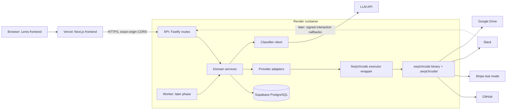
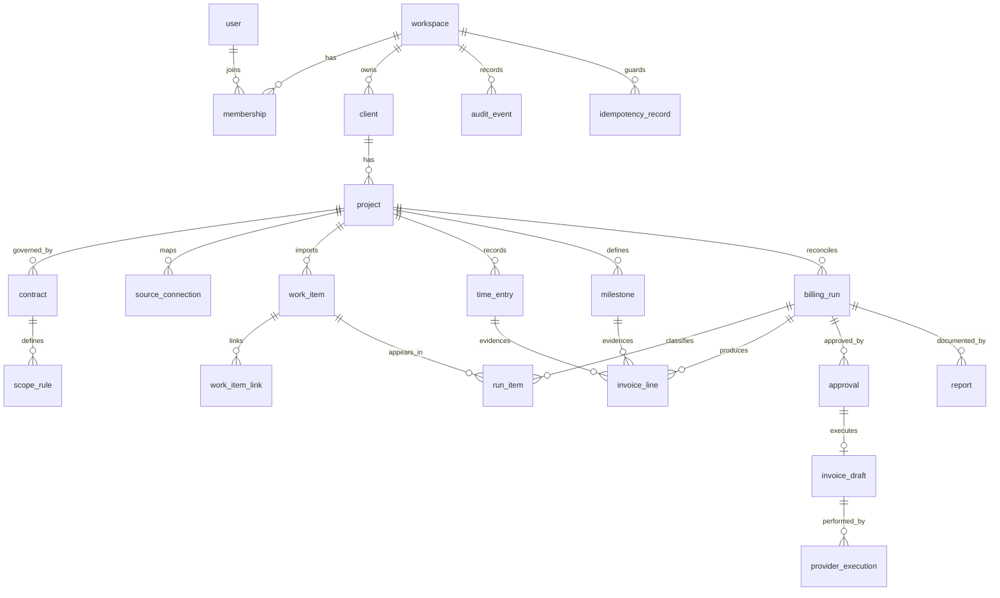
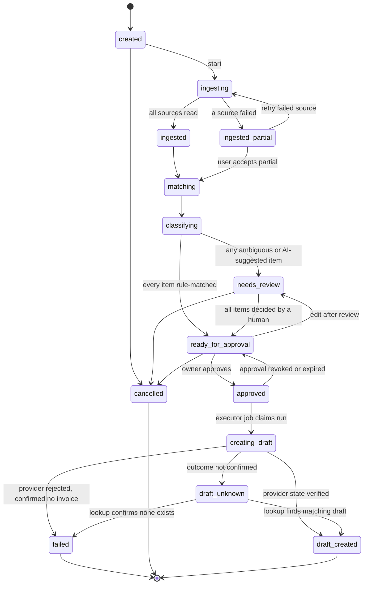

# VendorProof Architecture

**Product:** VendorProof  
**Tagline:** Verified work. Traceable invoices.  
**Version:** 1.0  
**Last updated:** 2026-11-04  

---

## 1. Product Identity

VendorProof is a deliverable reconciliation and invoice preparation platform for technical freelancers, consultants, fractional CTOs, and small software agencies.

It connects software development activity, contractual scope, approved billing evidence, and financial systems into an auditable reconciliation workflow.

### Target Users

- Solo technical freelancers
- Fractional CTOs
- Small software agencies
- Consultants who bill by time or milestones

### What VendorProof Is

- A reconciliation layer between development work and invoicing
- An evidence-backed billing system
- A workflow for approving and documenting billable work
- A bridge between GitHub activity and financial systems

### What VendorProof Is Not

- A time-tracking application
- A CRM
- A task manager
- An accounting ledger
- A GitHub dashboard
- A payment processor

---

## 2. Functional Requirements

### Core Workflow

1. Configure clients and projects
2. Associate projects with GitHub repositories and other verified work sources
3. Import relevant work items (PRs, commits, issues)
4. Associate work with contractual scope rules
5. Enter and approve time records or fixed-price milestones
6. Reconcile the billing period
7. Classify work using deterministic rules, with AI suggestions for ambiguous cases
8. Generate an evidence-backed billing report
9. Review the proposed invoice
10. Approve the reconciliation
11. Create a draft invoice using an approved financial integration

### Corrected Billing Requirements

**Non-negotiable rules:**

- A merged PR does not prove hours worked
- A closed issue does not prove hours worked
- Commit count does not prove hours worked
- Code complexity does not prove billable time
- An LLM must never invent hours, rates or monetary amounts

Every billable line must be supported by either:

1. A human-approved time entry
2. A human-approved fixed-price milestone

### Release One Scope

**Supported:**
- Manual time entries
- Fixed-price milestones
- GitHub read access for work evidence
- One verified financial provider (Stripe preferred)
- Draft invoice creation only
- Dashboard-only approval

**Deferred:**
- Time-tracking integrations (Harvest, Toggl, Clockify)
- Linear integration
- Google Drive integration
- Slack notifications
- Slack interactive approval
- QuickBooks Online (fallback only)
- Automatic invoice finalisation
- Automatic invoice sending
- Payment collection

### Explicit Assumptions

- **A1.** The user is a solo freelancer or small agency owner, so one workspace per signed-up account is enough for release one.
- **A2.** Time evidence is entered manually inside VendorProof first; a time-tracker integration is added only if its methods are verified.
- **A3.** Invoices are issued in one currency per project.
- **A4.** The web app stack is TypeScript end to end.
- **A5.** The existing Lenis frontend is a static or lightly dynamic site that can be adapted; it has not been inspected yet.

---

## 3. Architecture Overview

### Technology Stack

| Concern | Choice | Rationale |
|---|---|---|
| Language | TypeScript, strict mode | One language for API, worker and shared types |
| API framework | Fastify | Small, schema-first, easy to test; avoids tying backend to frontend framework |
| Database | PostgreSQL | Transactions, partial unique indexes and row locks needed for idempotency |
| ORM and migrations | Drizzle with SQL migrations | Supports partial indexes and keeps migrations reviewable as plain SQL |
| Validation | Zod, shared by API and frontend | One schema source for requests, provider payloads and LLM output |
| Background jobs | pg-boss on the same Postgres | Durable jobs without a second datastore |
| Sessions | Server-side sessions in Postgres, `HttpOnly` cookie | Revocable on sign-out |
| PDF | PDFKit | Pure JavaScript, no headless browser to patch |
| Logging | pino with redaction | Structured logs with correlation IDs |
| Tests | Vitest, Playwright, real Postgres in tests | Unit, integration, E2E with real database |
| LLM | Direct call to one model API with schema-constrained output | Model is a data processor, not a business-API provider |
| Hosting | Vercel for the Next.js frontend, Render for the long-running Fastify API, Supabase for managed PostgreSQL | Keeps the frontend framework-hosted while the API uses a persistent container and managed Postgres; worker hosting is deferred until durable jobs exist |

### Architecture Pattern

**Decision:** A TypeScript modular monolith with two processes from one codebase (API and worker), one PostgreSQL database, and one server-side Swytchcode executor.

**Rationale:**
- The runtime SDKs only wrap the `swytchcode` CLI binary, so the API and worker must run somewhere the binary and a `.swytchcode/` directory can live
- This means a long-running container, not edge or short-lived serverless functions
- A modular monolith keeps process responsibilities separate without the complexity of microservices
- Single codebase reduces deployment complexity while maintaining clear module boundaries

### Architecture Diagram



---

## 4. Component Responsibilities

| Component | Owns | Must never |
|---|---|---|
| Frontend | Rendering, forms, calling the API | Hold secrets, call providers, decide authorisation |
| API routes | Auth, input validation, tenant scoping, calling services | Contain business rules or provider calls |
| Domain services | Billing, matching, state machine, approvals, idempotency | Read provider response shapes directly |
| Provider adapters | Translate internal commands to canonical-ID calls and back to domain models | Be called from routes or components |
| Swytchcode executor | The only code that runs `swytchcode exec`; timeouts, validation, error classes, audit capture | Accept a canonical ID not on the allowlist |
| Classifier client | Build the prompt, call the model, validate output against a Zod schema | See money, hours or tokens; trigger any write |
| Worker | Long jobs: ingest, classify, render report, create draft invoice | Run a job without a persisted job record |
| PostgreSQL | System of record, constraints, audit events | Be bypassed by caches for approval state |
| Swytchcode CLI and `.swytchcode/` | Trusted tool list, credentials, policy, execution log | Be edited by an AI agent at runtime |

---

## 5. Data Model Overview

### Table Count

**Twenty-one tables** planned for the complete system.

### Key Tables

- **workspace, user, membership** - Multi-tenant foundation
- **client, project** - Client and project management
- **contract, scope_rule** - Contractual scope and billing rules
- **source_connection** - GitHub repository mapping
- **work_item, work_item_link** - Imported work evidence
- **time_entry, milestone** - Human-approved billing evidence
- **billing_run** - Reconciliation runs
- **run_item** - Classification decisions
- **invoice_line** - Billable lines
- **approval** - Approval records with content hashing
- **invoice_draft** - Provider draft invoices
- **provider_execution** - Swytchcode execution tracking
- **idempotency_record** - Idempotency guards
- **report** - Audit reports with hash verification
- **audit_event** - Insert-only audit trail

### ER Diagram



### Tenant Isolation

Every tenant table has `workspace_id NOT NULL`, and foreign keys use `(workspace_id, id)` pairs so a row can never point at another workspace's row.

**Implementation:**
- Application queries always filter by the session's workspace
- Postgres row-level security is enabled as a second layer
- Unknown or other-workspace IDs return 404, not 403

---

## 6. Billing Evidence Model

### Billing Engine Rules

1. A billable line exists only if it cites an approved `TimeEntry` or an approved `Milestone`
2. A time entry has integer minutes, a date, a description, an author and an approver
3. Work items without time are evidence only; they never produce an amount by themselves
4. Contracts hold: contract type, currency, hourly rate in minor units, rounding increment and mode, optional hour cap, and scope categories
5. Rounding is applied per time entry, then entries are summed
6. Billing periods are half-open intervals `[start, end)` evaluated in the project's stored IANA time zone
7. Amounts carry a stage: `estimated`, `proposed`, `approved`, `draft_invoice`, `finalised`
8. Hour caps and included allowances reduce the billable amount deterministically

### Deterministic Billing Rules

**Amount calculation (integer arithmetic only):**

```text
line_minor = (rounded_minutes * hourly_rate_minor + 30) // 60   # half-up, integers only
```

**Rounding modes:**
- `up`: Always round up to the next increment
- `nearest`: Round to nearest increment, with ties rounding up

**Zero-rounded entries:**
- Never silently dropped
- Flagged for human decision
- Shown as "unlinked evidence" with a written note

### AI Classification Boundaries

**What the AI sees:**
- Work item titles
- Linked issue text
- Project's scope rules

**What the AI never sees:**
- Rates
- Money amounts
- Hours
- Tokens

**What the AI output contains:**
- Item ID (must match an item sent)
- Category (enum from contract's scope rules plus "unclear")
- Confidence (low, medium, high)
- Short reason
- Client-friendly description

**No field exists for hours, amounts, or status.**

**Classification outcomes:**
- `rule_matched` - Deterministic rule applied
- `ai_suggested` - AI suggestion, requires human review
- `needs_review` - Ambiguous, requires human decision
- `approved` - Human has approved the classification

---

## 7. Reconciliation State Machine

### States



### State Transition Rules

| Rule | Detail |
|---|---|
| Valid transitions | Only the arrows above; a service function per transition checks the current status inside a transaction |
| Invalid examples | `approved` to `needs_review` without revoking approval; anything out of `draft_created`, `failed` or `cancelled`; `creating_draft` to `approved` |
| Locking | Each transition is `UPDATE billing_run SET status = $new, version = version + 1 WHERE id = $id AND version = $v AND status = $old`; zero rows means reload |
| Partial data | `ingested_partial` sets `completeness = partial`; the UI shows it on every later screen and the report states which source was incomplete |
| After approval | Editing a line, a rate or a classification clears the approval, writes an audit event and returns the run to `ready_for_approval` |
| Cancellation | Not allowed once `creating_draft` has begun; the run must reach a terminal state through verification |

---

## 8. Approval Workflow

### Approval Model

The VendorProof dashboard is the authoritative approval interface.

**Slack is notification-only in release one.**

### Approval Requirements

1. Only an owner can approve
2. The request must come from an authenticated session that authenticated within the last 15 minutes
3. The page loads with a one-time approval token bound to run ID, run version and session
4. The approval stores `content_hash` over the canonical JSON of: ordered lines, recipient, currency, totals, period, contract snapshot version, and report version with its SHA-256
5. The approval expires after 24 hours
6. The approver and time are recorded; a self-approval in a solo workspace is labelled as such
7. The run must be complete, or partial with an explicit user acceptance recorded earlier

### Confirmation Screen

Shows from the database (not from the browser):
- Client
- Project
- Billing period and time zone
- Invoice recipient
- Currency
- Every line with its evidence (time entry or milestone), minutes or milestone quantity, rate, and amount
- Visible reduction lines for hour caps and included allowances
- Subtotal
- Configured tax line
- Total
- Completeness label (complete or partial, with the missing source named)
- Count of items decided by a human versus rule-matched
- Audit report version and the first characters of its SHA-256
- Plain statement that only a draft will be created and nothing will be sent or charged

---

## 9. Financial Execution Workflow

### Financial Restrictions

**Release one only:**
- Invoice draft creation only
- No automatic invoice finalisation
- No automatic invoice sending
- No payment collection
- No charges
- No refunds
- No modification of unrelated accounting records

### Execution Sequence

1. **Approve call:** validates token and version, inserts the approval row, writes an audit event
2. **Claim:** one transaction moves the run to `creating_draft`, inserts `provider_execution` with key `invoice:{run_id}:{approval_id}`, and enqueues the job under the same singleton key
3. **Worker revalidates:** recomputes the hash from the database; recomputes every amount with the engine and compares to the stored line amounts; checks the currency, recipient and total are unchanged
4. **Pre-flight:** financial key matches the environment; total is greater than zero; recipient exists; no `invoice_draft` exists for this approval
5. **Write:** through the adapter and executor, one attempt, with the provider idempotency key and metadata if the verified method supports them
6. **Read back:** through a verified read method and run the verification checks
7. **Record:** `invoice_draft`, update the run, write the audit event, enqueue the optional Slack notification

### Verification and Outcome Mapping

| Observed result | Run state | Retry allowed |
|---|---|---|
| Draft read back; status draft; currency, total and line count match | `draft_created` | Not needed |
| Provider rejected with a clear validation error and a read confirms no invoice | `failed` | New approval only, after the cause is fixed |
| Timeout, connection reset, 5xx, or response that cannot be parsed | `draft_unknown` | Never resend; lookup by stored metadata or human check |
| Invoice found but status, currency, total or lines differ | `draft_unknown`, flagged for human | No |
| Authentication failure | `failed`, provider marked disconnected | After reconnect, with a new approval |

### Duplicate Invoice Prevention

1. **Approval step:** unique constraint allows one live approval per run
2. **Claim step:** deterministic key on `provider_execution` and singleton job
3. **Revalidation:** job recomputes the hash from the database; mismatch aborts
4. **Provider-side guard:** send idempotency key and metadata if the verified method supports them
5. **Unknown outcome:** on timeout or ambiguous response, mark `draft_unknown` and never resend
6. **Verification:** read the invoice back and check status, currency, total, and line count

---

## 10. Provider Adapter Design

### Provider Adapters

Located in `server/src/providers/`, adapters translate domain commands to canonical-ID Swytchcode calls and responses back to domain models.

**Planned adapters:**
- `providers/github` - Work source (read)
- `providers/stripe` - Financial provider (write + read)
- `providers/drive` - Report storage (write)
- `providers/slack` - Notifications (write)

### Core Interfaces

```typescript
interface WorkSourceProvider {
  listWorkItems(ctx: WorkspaceContext, source: SourceRef, period: Period, cursor?: Cursor): Promise<Page<WorkItemDraft>>
  getWorkItem(ctx: WorkspaceContext, source: SourceRef, externalId: string): Promise<WorkItemDraft>
}

interface InvoiceProvider {
  createDraft(ctx: WorkspaceContext, cmd: CreateDraftCommand, key: IdempotencyKey): Promise<ExecutionResult<ProviderInvoiceRef>>
  readInvoice(ctx: WorkspaceContext, ref: ProviderInvoiceRef): Promise<ProviderInvoiceView>
  findByMetadata?(ctx: WorkspaceContext, meta: RunMetadata): Promise<ProviderInvoiceRef | null>
}

interface ReportStore {
  put(ctx: WorkspaceContext, report: ReportFile): Promise<StoredReportRef>
}

interface Notifier {
  notify(ctx: WorkspaceContext, event: NotificationEvent): Promise<void>
}
```

**Note:** `findByMetadata` exists only if a verified read method supports it.

---

## 11. Swytchcode Execution Architecture

### Execution Model

**Decision:** One server-side executor module is the only code in the system that can invoke Swytchcode.

Located in `server/src/swytchcode/executor.ts`.

### Executor Rules

1. Accepts only a canonical ID that is on a code-level allowlist generated from verified methods in `docs/api-inventory.md`
2. Validates input with a Zod schema derived from the Wrekenfile input schema, and validates the parsed output the same way
3. Adds what the SDKs do not: a hard timeout, a concurrency limit per provider, a typed error class, secret redaction, and a correlation ID
4. Writes a `provider_execution` row as pending before the call and finalises it after, storing request_hash and a response summary, never secrets
5. Never retries a write. Retry policy lives in the error handling layer
6. Is injected into adapters as an interface so tests can substitute a fake

### Swytchcode Artefacts

| Artefact | Role | Who may change it |
|---|---|---|
| `.swytchcode/tooling.json` | Defines which integrations and tools are trusted | A human only, through a reviewed pull request |
| Wrekenfiles | Define what a provider can do: methods, canonical IDs, schemas | Generated by `swy get`; never hand-edited |
| `methods.json`, `workflows.json` | Fetched beside each Wrekenfile | Generated |
| `manifest.json` | Per-integration retries, timeouts, concurrency, idempotency settings | Human, reviewed |
| `policies.json` | Execution policies evaluated before a call | Human, reviewed |
| Swytchcode account token | Authenticates the runtime | Secret manager only |
| Provider credentials | Separate from the Swytchcode token | Secret manager only |

### Sandbox versus Deployment Environment

The `tooling.json` mode (sandbox) is a Swytchcode setting. It is not the deployment environment of the web app.

- The app has its own `APP_ENV` (development, staging, production)
- At startup, a financial adapter refuses to run if `APP_ENV` is not production and the configured Stripe key does not carry the test-mode prefix
- Production APIs are never the default test target

---

## 12. Background Job Responsibilities

### Worker Jobs

Located in `server/src/jobs/`, using pg-boss on the same PostgreSQL database.

**Planned jobs:**
- `ingest-run` - Import work items from connected sources
- `classify-run` - Classify work items using rules and AI
- `render-report` - Generate PDF audit report
- `upload-report` - Upload report to Google Drive
- `notify` - Send Slack notifications
- `create-draft-invoice` - Create draft invoice through financial provider
- `reconcile-pending-executions` - Reconcile pending executions at startup

### Job Rules

- Each job loads its run from the database, checks the state, and does nothing if the state no longer matches
- `create-draft-invoice` has a retry limit of zero
- Jobs marked safe to repeat (ingest, classify, render) can be retried
- Invoice jobs never auto-retried

---

## 13. Report Generation and Integrity

### Report Lifecycle

1. The worker renders the PDF with PDFKit from database rows only (never from live provider calls), at `ready_for_approval`
2. It computes SHA-256, stores bytes, size and hash in `report` (run_id, version), and writes an audit event
3. A new run version produces a new report version. Older versions remain
4. Upload to Drive happens after the database write, through a verified Swytchcode method, and stores `drive_file_id`
5. Approval requires a database report, not a successful Drive upload

### Integrity Verification

- Viewing a report recomputes the hash of the stored bytes and compares it with the recorded one
- An on-demand check can download the Drive copy and compare. A mismatch is shown as modified outside VendorProof and raises an audit event
- UI wording: "recorded and hash-verified", never "immutable" or "tamper-proof"

### Report Contents

- Client, project, period
- Contract snapshot version
- Completeness label
- Every work item with its original provider link
- Classification source (rule, AI suggestion, or human) and decision
- Every time entry and milestone
- Calculations
- Approver and time
- List of anything excluded and why

---

## 14. Failure Handling

### Error Classes

| Class | Examples | Handling |
|---|---|---|
| validation | Input fails schema | Reject, 422, no provider call |
| auth | Token or credential rejected | Mark provider disconnected, stop writes, tell the owner |
| permission | Provider scope missing | Fail with a specific message; no retry |
| rate_limit | Provider throttling | Honour retry-after; back off; run becomes partial if budget exhausted |
| timeout | No answer in time | Read: retry. Write: unknown, never resend |
| provider_5xx | Server error | Read: retry. Write: unknown |
| provider_4xx | Rejected request | No retry; record summary |
| schema_mismatch | Output differs from the Wrekenfile schema | Treat as unknown for writes, failed for reads; raise an alert |
| internal | Our bug | Fail the job; keep state consistent through transactions |

### Retry Rules

| Operation | Policy |
|---|---|
| Provider read | Up to 3 attempts, exponential backoff with jitter, cap 20 seconds |
| Provider write without verified idempotency key | Zero automatic retries |
| Provider write with verified idempotency key | One retry with the same key, only after a read confirms no draft exists |
| Classification call | One retry on invalid schema or transport error; then needs_review |
| Job (pg-boss) | Retry only jobs marked safe to repeat; invoice job retry limit is zero |

### Circuit Breaker

Per provider: five consecutive failures within 60 seconds opens the breaker for 60 seconds; reads fail fast with a partial result.

---

## 15. Deployment Architecture

### Current Status

**NOT DEPLOYED**

This is an initial architecture document. No production deployment has been performed.

### Planned Deployment

- Container host with managed PostgreSQL
- Single container image containing API and worker processes
- Separate process entry points: `npm run start:api` and `npm run start:worker`
- Environment-specific configuration via environment variables
- Swytchcode CLI binary installed in the container
- `.swytchcode/` directory mounted or initialised at build time
- `SWYTCHCODE_TOKEN` as a process environment secret
- Provider credentials supplied as environment variables from secret manager

### Environments

- **development:** Local development with sandbox Swytchcode mode
- **staging:** Staging environment with test provider accounts
- **production:** Production environment with production provider credentials

See `docs/production.md` for detailed deployment runbook.

---

## 16. Frontend Structure

### Planned Integration

The existing Lenis scrolling frontend will be integrated into `apps/web/`.

**Preservation rules:**
- Original design system
- Fonts and typography
- Colours
- Components
- Visual hierarchy
- Animations
- Lenis scrolling configuration
- Transitions
- Responsive layouts
- Existing assets

### Page Map

| Route | Purpose | Permission |
|---|---|---|
| `/` | Landing page, the existing Lenis site | Public |
| `/sign-in` | Authentication | Public |
| `/app` | Dashboard: runs needing attention, recent drafts, provider health | Any member |
| `/app/clients` and `/app/clients/:clientId` | Client list; client detail with projects | Member read; admin write |
| `/app/projects/:projectId` | Tabs: Overview, Connections, Contract, Time, Milestones, Runs | Member read; admin write; approve time: admin |
| `/app/runs/:runId` | Run workspace with steps: Sources, Work items, Classification, Invoice preview, Approval, Execution | Member review; owner approve |
| `/app/runs/:runId/report` | Audit report viewer with hash status | Admin; member own runs |
| `/app/activity` | Execution history and audit events | Admin read |
| `/app/settings` | Workspace, members, provider connection status, export and deletion | Owner |

### Frontend Rules

1. The browser calls only the VendorProof API. No provider, Swytchcode or LLM call exists in frontend code
2. Money is an integer plus an ISO currency code. A single `MoneyText` component formats it
3. Types come from the shared Zod schemas in `packages/shared`
4. No secrets, tokens or workspace IDs in frontend variables
5. Provider-sourced text is rendered as plain text, never as HTML
6. Lenis: kept as is on public pages. Inside the app, scrollable overlays, tables and dialogs carry the Lenis prevent attribute

---

## 17. Backend Structure

### Modules

One codebase, one deployable image, two process types (api, worker). Modules sit under `server/src`.

| Module | Responsibility |
|---|---|
| `auth` | Sessions, CSRF, membership, role checks |
| `workspaces`, `clients`, `projects` | CRUD with workspace scoping and archive rules |
| `contracts` | Versioned contracts, scope rules, snapshot builder |
| `sources` | Repository mapping and validation |
| `work-items` | Import, deduplicate, link, hash |
| `time` | Time entries, milestones, approvals |
| `billing` | Pure engine: rounding, minutes, caps, tax line, totals |
| `classification` | Rule matcher, prompt builder, classifier client, output validator |
| `runs` | State machine, one function per transition, optimistic locking |
| `approvals` | Tokens, approval rows, content hashing |
| `invoices` | Claim, revalidate, create draft, verify, resolve unknown |
| `reports` | PDF rendering, hashing, storage, integrity check |
| `notifications` | Outbound messages |
| `audit` | Insert-only events with hash chain |
| `swytchcode` | Executor, allowlist, error classes |
| `providers/*` | Adapters mapping domain commands to canonical IDs |
| `jobs` | pg-boss definitions and handlers |
| `platform` | Config, logger, errors, HTTP plumbing |

### Dependency Rules

- Routes call services
- Services call repositories and interfaces
- Only `providers/*` import swytchcode
- Only repositories import the database client
- Billing imports nothing
- Classification imports no provider and no database

---

## 18. Database Design Overview

### Planned Approach

- PostgreSQL as the system of record
- Drizzle ORM with SQL migrations
- Migrations are plain SQL files, reviewable in version control
- Partial unique indexes for idempotency and overlap prevention
- Row-level security as a second layer of tenant isolation
- Composite foreign keys using `(workspace_id, id)` pairs

### Migration Discipline

- Migrations are incremental and added only when the feature is implemented
- No speculative migrations for future features
- Each migration is tested against an empty database and the previous schema
- Migrations that modify data are reversible
- Migration files are never edited after being applied

### Tenant Isolation

- Application queries always filter by the session's workspace
- Postgres row-level security is enabled as a second layer
- A lint rule forbids importing the database client outside `src/db` and repositories
- Unknown or other-workspace IDs return 404, not 403

### Testing Requirements

- Real PostgreSQL in integration tests
- Test database is created fresh for each test run
- Migrations are tested up and down
- RLS is tested with two-workspace suites

---

## 19. Workspace Isolation Strategy

### Initial Operational Setup

**Single-workspace and single-provider-account** until Swytchcode's server-side per-workspace credential-selection capability is verified.

### Workspace Identity

- Workspace identity must come from an authenticated server-side session
- Never from browser-controlled workspace IDs
- Never from query strings, headers, or request bodies

### Multi-Tenant Readiness

The data model is workspace-aware from the beginning, but:
- Release one connects one provider account per workspace
- A future multi-tenant feature requires verification of Swytchcode's per-workspace credential selection
- Do not claim multi-tenant SaaS support merely because workspace IDs exist in tables

---

## 20. AI Classification Boundaries

### What the AI Sees

- Work item titles
- Linked issue text
- Project's scope rules

### What the AI Never Sees

- Rates
- Money amounts
- Hours
- Tokens
- Client names (unless explicitly enabled)

### What the AI Output Contains

- Item ID (must match an item sent)
- Category (enum from contract's scope rules plus "unclear")
- Confidence (low, medium, high)
- Short reason
- Client-friendly description

**No field exists for hours, amounts, or status.**

### Classification as Suggestion

- AI classification is a suggestion
- A human must approve ambiguous classifications
- The AI never creates hours, rates, tax values or amounts
- All money calculation is deterministic
- The AI never initiates or approves a financial operation

### Prompt Injection Protection

- The classifier has no tools, no network access, no database access and no secrets
- Output schema: item ID, category, confidence, reason, description
- The prompt places instructions first, wraps each item's text in clearly delimited data blocks
- The backend rejects any output that fails the schema, names a category not in the contract, references an unknown item ID, or exceeds length limits
- One retry, then the item becomes `needs_review`
- Output is always stored as `ai_suggestion` and displayed as plain text

---

## 21. Integration Scope

### Initial Integration Sequence

| Provider | Purpose | Initial status |
|---|---|---|
| GitHub | Read pull requests, commits and work evidence | Must be verified |
| Stripe | Create draft invoices in test mode | Preferred financial candidate; must be verified |
| Google Drive | Store a private audit-report copy | Future milestone; must be verified |
| Slack | Send approval-needed notifications | Future milestone; must be verified |
| Linear | Additional ticket scope information | Optional; must be verified |
| QuickBooks Online | Alternative financial provider | Fallback; must be verified |

### First Functional Path

GitHub read access, internal approved time/milestone records and one verified financial provider.

### Verification Requirements

No provider method is implemented until it has been verified against its actual downloaded Wrekenfile and schema.

See `docs/api-inventory.md` for the current verification status of each provider.

---

## 22. Incremental Implementation

### Implementation Strategy

- Do not implement the complete 21-table database schema in the initial bootstrap
- Do not write speculative migrations
- Implement features incrementally as milestones
- Add dependencies when their milestone requires them
- Test each milestone before moving to the next

### Planned Milestones

1. **Foundation:** Backend scaffold, health endpoints, basic configuration
2. **Authentication:** Session management, CSRF, membership
3. **Core CRUD:** Workspaces, clients, projects, contracts
4. **Work Sources:** GitHub integration and work item import
5. **Time Evidence:** Time entries and milestones
6. **Billing Engine:** Rounding, calculations, invoice preview
7. **Classification:** Rule matching and AI classification
8. **Reconciliation:** State machine and approval workflow
9. **Financial:** Stripe integration and draft invoice creation
10. **Reporting:** PDF generation and audit reports
11. **Frontend:** Lenis integration and full UI
12. **Production:** Deployment and monitoring

Each milestone has its own verification criteria and must pass all tests before proceeding.

---

## 23. Bootstrap Refinements

This architecture document is based on the Claude architecture package (Sections 1-17 from `_planning-input/vendorproof-architecture-part1.md` and `_planning-input/vendorproof-architecture-part2.md`).

**Note:** The Part 2 filename claims Sections 7-28, but the actual content ends at Section 17. Sections 18-28 were not provided in the source material.

### Bootstrap-Specific Decisions

The following decisions are bootstrap refinements made during initial repository setup:

- Repository structure follows the approved modular monolith pattern
- Documentation system is created before implementation
- Engineering rulebook is established to guide AI agents
- Minimal runnable backend is created to prove the foundation
- Git repository is initialised with proper hygiene
- GitHub repository connection is established

These refinements are implementation scaffolding decisions, not changes to the approved architecture.

---

## 24. References

### Official Documentation

- https://docs.swytchcode.com/
- https://docs.swytchcode.com/cli/projects/
- https://docs.swytchcode.com/cli/integrations/
- https://docs.swytchcode.com/cli/mcp/
- https://docs.swytchcode.com/cli/authentication/
- https://docs.swytchcode.com/configuration/tooling-json/

### Internal Documentation

- `docs/api-inventory.md` - Provider method verification register
- `docs/decisions.md` - Architectural decision register
- `docs/tradeoffs-considered.md` - Trade-off documentation
- `docs/production.md` - Production runbook
- `docs/threat-model.md` - Threat model
- `docs/security-review.md` - Security review register
- `docs/performance-review.md` - Performance review
- `docs/testing-strategy.md` - Testing strategy
- `docs/verified-facts.md` - Verified environment facts
- `docs/friction-diary.md` - Setup and development friction log
- `rules.md` - Engineering rulebook
- `AGENTS.md` - Instructions for AI coding agents

### Source Architecture

- `_planning-input/vendorproof-architecture-part1.md` - Sections 1-6
- `_planning-input/vendorproof-architecture-part2.md` - Sections 7-17

---

**Document status:** Architecture approved, implementation in progress.
